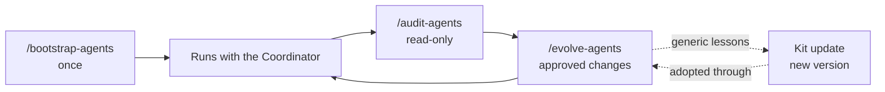

# Specialized agent kit

A versioned kit for creating, evolving, and auditing a private team of VS Code agents in data-science repositories. It was generalised from a working repository in which the roles, handoff files, gates, and writing standards were refined over several runs.

Scope: data science, machine learning, deep learning, data engineering, data architecture, Python and SQL, and visualisation.

## Contents

| Path | Purpose |
| --- | --- |
| `kit.json` | Kit version, CCDS release followed, default environment |
| `ROLE_CATALOG.md` | The nine roles, fixed models, ownership, and when to include each |
| `CHANGELOG.md` | Kit versions and the lessons each one adopted |
| `prompts/` | Full procedures: `bootstrap-agents.md`, `evolve-agents.md`, `audit-agents.md` |
| `user-prompts/` | Thin VS Code slash commands that point to `prompts/` |
| `templates/roles.json` | Machine-readable role definitions |
| `templates/private/` | Everything rendered into a repository's `.github/` |
| `templates/hooks/pre-commit` | Outer-repository hook that rejects staged `.github` paths |
| `skeleton/ccds_v2_minimal/` | Minimal Cookiecutter Data Science v2 structure for empty repositories |
| `skeleton/CCDS_SOURCE.md` | CCDS release followed and the documented deviations |
| `tools/kit_render.py` | Deterministic, create-only renderer (standard library only) |
| `tests/test_kit.py` | Kit tests |

## Installation

The slash commands are VS Code user prompt files. Copy them once to the user prompts folder:

```powershell
Copy-Item C:/Users/10550/REDLEN_DS/MY_SPECIALIZED_AGENTS_/user-prompts/*.prompt.md "$env:APPDATA/Code/User/prompts/"
```

They then appear in Chat in every workspace as `/bootstrap-agents`, `/evolve-agents`, and `/audit-agents`. A prompt file runs only when typed; it never runs automatically. Each one contains a single instruction to read and follow the matching procedure in `prompts/`, so the procedures stay in one versioned place.

Requirements: Git on `PATH`, conda, and an environment with Python 3.10 or later. The private documentation builder also needs `markdown` (and `pymdown-extensions` for equations); the kit never installs them.

## Lifecycle



1. **Bootstrap** (once per repository). Pre-flight checks, discovery or interview, proposed roster and settings, your approval, deterministic render, repository-specific filling, audit, commit to the private history.
2. **Work.** Multi-stage runs through the Coordinator, with handoff files and the ledger as the record.
3. **Audit.** Read-only checks at any time.
4. **Evolve.** Evidence from the ledger, `lessons`, and repository changes becomes proposed edits; nothing is applied without approval; every change is logged and committed.
5. **Kit update.** Lessons that apply to every repository are added to the kit as a new version.

## Empty and existing repositories

| | Greenfield (empty folder) | Existing repository |
| --- | --- | --- |
| Discovery | Interview: goal, data, confidentiality, deliverables, modeling, names, environment | Inventory of layout, data, tests, docs, conventions |
| Skeleton | CCDS v2 minimal structure rendered | Not rendered; existing layout kept |
| Roster | Small: Coordinator, Researcher, Data Engineer, Statistical Reviewer | Chosen from evidence |
| Paths in agent files | Kit defaults; missing paths marked "(planned)" | Mapped to the repository's real paths |
| Conflicts | None expected | Written to `.github/agents/_proposals/` for review |

## Safety layers

| Layer | Protects against |
| --- | --- |
| Marker `.github/agents/.kit.json` | A second bootstrap: the procedure and the renderer both refuse |
| Create-only renderer | Overwriting files: conflicts become proposals |
| Dry run before render | Unexpected file lists |
| Pre-flight: clean outer tree, no tracked `.github` | Mixing kit files with uncommitted work; repositories that publish `.github/` |
| `.git/info/exclude` and the pre-commit hook | Private files entering the outer repository |
| Private repository in `.github/` | Losing or being unable to undo agent changes; `git clean -fdx` in the outer repository |
| Separate commands | Accidental changes: only `/evolve-agents` edits an existing workspace, and only after approval |

## Undo

```powershell
git -C .github log --oneline           # private history
git -C .github revert <commit>         # undo one change
```

The private history covers `.github/` only. Code is restored through the outer repository; generated outputs are regenerated from their run record.

## Deliberate re-bootstrap

Re-bootstrapping is rarely needed; prefer `/evolve-agents`. If it is needed:

1. Commit the private history and copy `.github/` to a backup folder outside the repository.
2. Delete `.github/agents/.kit.json` by hand.
3. Run `/bootstrap-agents`. Existing files become proposals; nothing is overwritten.

## The shared environment

`DS_002` is the default environment for repositories without their own. Because it is shared, every handoff records a package-list hash (`ledger.py env-hash`), and installs require approval. A repository with a dedicated environment sets it once at bootstrap (`--conda-env`); the agent files never name an environment directly. `/evolve-agents` can move a repository from `DS_002` to a dedicated environment.

## Maintaining the kit

The kit is a local Git repository, tagged by version.

1. Change templates, prompts, or the skeleton.
2. Run the tests: `conda run -n <env> python -m pytest -q -p no:cacheprovider` from the kit root.
3. Update `kit.json` (`kit_version`) and `CHANGELOG.md`.
4. Commit and tag: `git tag v<version>`.

Before adding a lesson from a repository, remove project names, paths, data descriptions, and anything confidential.

## Known limitations

- The kit assumes a repository publishes nothing under `.github/`. A repository that needs public `.github/` content (for example CI workflows) is refused at pre-flight and needs a separate decision.
- Model labels request a model; they do not guarantee a model snapshot. Record the actual model when the client reports it.
- Agents cannot run notebook cells with the default tools; long notebooks are run by the user.
- The skeleton follows CCDS `v2.3.0` by hand; later CCDS releases are not adopted automatically (see `skeleton/CCDS_SOURCE.md`).
