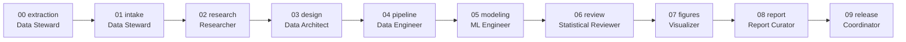

# Role catalog

Nine roles cover data science, machine learning, deep learning, data engineering, data architecture, Python and SQL, and visualisation. Models are fixed per role. Each role is written as a staff-level practitioner with fifteen years of experience; the seniority is expressed as concrete behaviour in each agent's **Professional standard** section and in the shared standard in `copilot-instructions.md`.

The machine-readable source is `templates/roles.json`; the templates are in `templates/private/agents/`. The kit tests check that the three agree.

## Summary

| Role | Model | Tools | Stage | Handoff | Owns |
| --- | --- | --- | --- | --- | --- |
| Coordinator | Claude Opus 5.5 | read, search, edit, execute, agent | all, 09 | `09_release.json`, `06_review.json` | Stage plan, gates, ledger, release record |
| Data Steward | GPT-6 Luna | read, search, edit, execute | 00, 01 | `00_extraction.json`, `01_intake.json` | Input provenance, manifests, intake quality, sharing checks |
| Researcher | Claude Opus 5.5 | read, search, edit, execute | 02 | `02_research.json` | Hypotheses, discriminating tests, research briefs |
| Data Architect | Claude Opus 5.5 | read, search, edit, execute | 03 | `03_design.json` | Schemas, data contracts, storage layout, lineage, design records |
| Data Engineer | GPT-6 Astra | read, search, edit, execute | 04 | `04_pipeline.json` | Pipelines, Python and SQL transformations, features, tests |
| ML Engineer | GPT-6 Astra | read, search, edit, execute | 05 | `05_modeling.json` | Training, evaluation, model artifacts, model cards |
| Statistical Reviewer | GPT-6.1 Sol | read, search | 06 | Returned in chat | Independent read-only review |
| Visualizer | Claude Sonnet 5.5 | read, search, edit, execute | 07 | `07_figures.json` | Plotting code and publication figures |
| Report Curator | Claude Sonnet 5.5 | read, search, edit | 08 | `08_report.json` | Peer-facing documents |

## When to include each role

| Role | Include when | Usually omit when |
| --- | --- | --- |
| Coordinator | Always | Never |
| Data Steward | Inputs arrive from outside the repository, are large, restricted, or versioned | Data are generated inside the repository |
| Researcher | Open analytical or scientific questions drive the work | The work is pure implementation of a fixed design |
| Data Architect | Several datasets, stages, or consumers; schemas evolve; storage choices matter | One small table and one script |
| Data Engineer | Any pipeline or reusable calculation | Never for analysis repositories |
| ML Engineer | Models are trained, tuned, or evaluated | Descriptive or inferential statistics only |
| Statistical Reviewer | Results support decisions or publications | Exploratory sandboxes |
| Visualizer | Figures are delivered to others | Figures are only diagnostic |
| Report Curator | Peer-facing documents are delivered | No documents beyond the README |

A greenfield repository starts with Coordinator, Researcher, Data Engineer, and Statistical Reviewer. Other roles are added through `/evolve-agents` when the repository produces evidence that they are needed.

## Output ownership

Each location has one owner. The Statistical Reviewer writes nothing.

| Location | Owner |
| --- | --- |
| `data/raw/`, `data/input_manifest.json`, `runs/<run_id>/input_manifest.json` | Data Steward |
| `runs/research/<run_id>/`, `reports/research/` | Researcher |
| `docs/architecture/`, `configs/contracts/` | Data Architect |
| `data/interim/`, `data/processed/`, `runs/<run_id>/pipeline/`, `<module>/` (except below), `scripts/`, `tests/` | Data Engineer |
| `models/<run_id>/`, `runs/<run_id>/modeling/`, `<module>/modeling/`, `tests/modeling/` | ML Engineer |
| `<module>/plots.py`, `reports/figures/<run_id>/` | Visualizer |
| `README.md`, `docs/` (except `docs/architecture/`), `reports/*.md`, notebook Markdown | Report Curator |
| `.github/handoffs/<run_id>/06_review.json`, `09_release.json`, `ledger.csv` | Coordinator |

## Stage sequence

Stages without a role in the roster, or not needed for a run, are skipped and listed in `09_release.json` under `skipped_stages`.

## Changing the catalog

Add or change a role in the kit, not in one repository: update `templates/roles.json`, the agent template, this catalog, and the kit `CHANGELOG.md`; run the kit tests; tag a new kit version. Repositories adopt the change through `/evolve-agents`.
