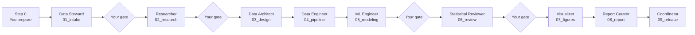

# Run procedure (private)

Step-by-step procedure for a stage-gated run with the workspace agents, and the practices that keep human-supervised, agent-assisted work reliable. Handoff fields are defined in `AGENT_GUIDE.md`; peer-facing stage gates are in `docs/WORKFLOW.md`.

## Overview

Stages whose role is not in this repository's roster are skipped. A reproduction asks no new question, so the Researcher is used only to explain a discrepancy.

## Standing decisions

| Decision | Choice |
| --- | --- |
| Run ID | `YYYYMMDD_<slug>` |
| Mismatch with expected numbers | Stop and report; no code or wording is adjusted to match |
| {{FILL: Repository-specific standing decision}} | {{FILL: Choice}} |

## Step 0: Prepare (you, no agents)

1. Confirm the environment: `conda run -n {{conda_env}} python -c "import sys; print(sys.executable)"`.
2. Confirm the outer working tree is committed: `git status` shows no changes and lists nothing under `.github/`.
3. Confirm the private history is committed: `git -C .github status` shows no changes.
4. In each agent switch, compare the model shown in the picker with the agent file. Stop if it differs.

## Step 1: Input intake (Data Steward)

Select **Coordinator** and paste:

> Run ID `<run_id>`. Goal: `<goal>`. Scope: `<scope>`. Acceptance: `<evidence>`. If any result differs from expectation, stop and report. Start with intake only: invoke the Data Steward to validate the inputs with SHA-256 hashes, write the manifest to `runs/<run_id>/input_manifest.json`, compare it with `data/input_manifest.json`, and write `01_intake.json`. Then stop and report.

Gate checklist:

- [ ] The validated file count matches the expected count, and hashes are included.
- [ ] Every manifest difference is explained.
- [ ] You ran one manifest check yourself.

Decision: approve the new manifest as authoritative before it replaces `data/input_manifest.json`.

## Step 2: Research (Researcher, when a question is open)

> Invoke the Researcher with `01_intake.json` and the question `<question>`. Require hypotheses, a discriminating test, results with uncertainty, and a proposed decision in `02_research.json`. Stop and report.

Gate checklist:

- [ ] Each hypothesis has a test that could falsify it.
- [ ] Observations, estimates, and interpretations are labelled.
- [ ] You decided on every item in `approval_questions`.

## Step 3: Design (Data Architect, when schemas or storage change)

> Invoke the Data Architect with the accepted handoffs. Require a design record, updated data contracts, and the migration impact in `03_design.json`. Stop and report.

Gate checklist:

- [ ] Each decision lists the options considered and its consequences.
- [ ] Contract changes are versioned and their consumers are listed.

## Step 4: Pipeline (Data Engineer)

> Invoke the Data Engineer with the accepted handoffs and frozen config `configs/<file>.yaml`. Run the tests, then the pipeline. Record every output with rows and SHA-256 in `04_pipeline.json`. Stop and report.

Gate checklist:

- [ ] Tests pass and `ruff check .` is clean.
- [ ] Row counts reconcile from inputs to outputs.
- [ ] Key numbers match expectations: {{FILL: expected-value table, or "defined per run"}}.

## Step 5: Modeling (ML Engineer, when models are trained)

> Invoke the ML Engineer with `04_pipeline.json`. Train and evaluate under the frozen split and seeds. Record metrics with uncertainty against the baseline in `05_modeling.json`. Stop and report.

Gate checklist:

- [ ] The split is fixed and leakage checks pass.
- [ ] Every metric has an interval or spread and a baseline.
- [ ] Model artifacts have SHA-256 hashes.

## Step 6: Review (Statistical Reviewer)

> Invoke the Statistical Reviewer on `04_pipeline.json` and `05_modeling.json`. Scope: `<claims under review>`. Record findings in `06_review.json`.

Gate checklist:

- [ ] Every finding is marked verified, approximate, or unverified.
- [ ] No blocking finding remains open.
- [ ] You read the findings yourself.

## Step 7: Figures (Visualizer)

> Invoke the Visualizer with the accepted handoffs. Produce figures from accepted outputs only and write `07_figures.json`.

Gate checklist:

- [ ] Each figure traces to a source artifact and a script.
- [ ] Axes, units, captions, and palette meet the peer-writing standard.

## Step 8: Reports (Report Curator)

> Invoke the Report Curator with the accepted handoffs. Update only accepted claims, run the number-preservation and link checks, and write `08_report.json`.

Gate checklist:

- [ ] Every added or removed numeric token is explained.
- [ ] You read `git diff` for each changed document.
- [ ] `conda run -n {{conda_env}} python scripts/build_docs.py --open` renders cleanly.

## Step 9: Release record (Coordinator)

> Assemble `09_release.json` for `<run_id>`, listing all handoff files, manifests, review findings, skipped stages, and open decisions. Run the ledger check.

Final decision (yours only): declare the run released, then commit the outer repository and the private history.

## Best practices

### You are the gate

- Agents propose and execute; only you approve design changes, thresholds, data sharing, and releases.
- One stage per prompt, ending with "stop and report".
- Approve from the handoff file, not the chat summary.

### Evidence over assertion

- A passing claim needs the command and its output.
- A matching claim needs an expected-versus-actual table.
- Rerun one cheap check yourself at every gate.

### Fix the contract before the run

- State scope, run ID, acceptance evidence, and mismatch policy in the first prompt.
- A frozen config, an approved input manifest, and a commit make the run reproducible.

### Separate roles

- The agent that produces a result never reviews it; the Statistical Reviewer is read-only for this reason.
- Reject a stage if an agent acts outside its role (for example, editing a threshold to make numbers match).

### Treat discrepancies as findings

- A mismatch is information about inputs, versions, or code: record it, explain it, then decide.
- Never adjust wording or numbers to fit expectations.

### Keep an audit trail

- One run ID, one handoff folder, and one output folder per run; never overwrite an earlier run.
- Keep historical runs as labelled evidence.
- Record the model that ran each stage; a substituted model is a reason to pause.

### Know the limits

- Agents have no memory between sessions; handoff files and the ledger are the memory.
- Agents can be confidently wrong; the gates exist to catch this.
- Some steps are faster and safer done by you, such as running a long notebook.
